# supabase-dev-container

> A standalone webdev workstation for local Supabase development

This project delivers a Linux web development workstation optimized for Docker Desktop on macOS, packaged as a `docker compose` service rather than a VS Code `.devcontainer`. It replicates the [artist-film-hub](https://github.com/) project devcontainer — Node.js 24 + Bun, the Supabase CLI, Xvfb/x11vnc for headful browser debugging, and Playwright system dependencies — while adopting the standalone-project layout of the [`dev-container`](../dev-container) reference (a `Dockerfile` + `docker-compose.yml` + docs/scripts you build and run directly).

The workstation is purpose-built for running a **local Supabase stack**: it ships the Supabase CLI and pairs with a `docker:dind` sidecar that runs the Docker daemon in the workstation's own network namespace. That shared netns is what lets `supabase start` bring up its service containers *and* have the CLI reach them at `127.0.0.1:5432x` — something a plain host-socket (DooD) setup cannot do, because DooD publishes those ports to the host's loopback instead of the container's. See [docs/security/dind-dood-security.md](docs/security/dind-dood-security.md).



### Versions

| Package | Version(s) |
| --- | --- |
| Node | 24 (via the Dev Containers base image) |
| Bun | 1.4.4 |
| Supabase CLI | latest (pin via `SUPABASE_VERSION`) |
| Docker CLI | bookworm stable (client only; daemon is the `dind` sidecar) |
| DinD daemon | 29.9.2 (pin via `DIND_VERSION`; matches a typical host Docker client) |

> Update Node/Bun/Supabase/DinD pins in [docker-compose.yml](docker-compose.yml) (build args / image tag), or override per-machine from `.env`.

### Features

* Node.js 24 (Dev Containers `typescript-node` base image) + Bun
* Supabase CLI for `supabase start` / local stack orchestration
* Docker-in-Docker (`docker:dind` sidecar sharing this container's network namespace) so the Supabase CLI launches its service containers *and* reaches them at `127.0.0.1:5432x`
* Playwright system dependencies (all three engines — Chromium, Firefox, WebKit)
* Xvfb + x11vnc for headful browser debugging, with on-demand start/stop helpers:
    * `xvfb-start` — start Xvfb and a localhost-only VNC server (attach via the forwarded port 5900)
    * `xvfb-stop` — stop both
* Named volume for a shared Playwright browser-binary cache across rebuilds
* Portable shell helpers: `git-check`, `git-check-remote`
* Custom seccomp profile so Chromium's zygote sandbox runs under Docker's default profile

## Usage

Build and run the stack (a `supabase-dev` workstation + a `dind` daemon sidecar):

```bash
cp .env.example .env        # then set PROJECTS_PATH, SSH_AUTH_SOCK, and DIND_VERSION for your machine
docker compose up -d
```

Attach to the running `supabase-dev` container from a terminal on the host:

```bash
docker compose exec supabase-dev bash
```

Inside the container, open one of your projects (mounted at `/workspace`) and start the local Supabase stack:

```bash
cd /workspace/<your-project>
bun install && bunx playwright install --with-deps chromium   # first time only
supabase start
supabase migration up --local
supabase status --output env   # prints API URL, publishable key, service-role key
```

`supabase start` publishes its local-stack ports into the shared netns, and the `dind` service forwards them out onto your Mac. From a terminal on the host they are reachable at:

| Port | Service (verified for Supabase CLI 2.122.x) |
| --- | --- |
| 54321 | Kong API gateway (`API_URL`) |
| 54322 | Postgres direct (TCP; binary protocol, not HTTP) |
| 54323 | Studio dashboard (`STUDIO_URL`) |
| 54324 | PostgREST |

> Exact port roles shift between Supabase CLI versions — check `supabase status --output env` for the authoritative mapping.

To view a headed browser live, run `xvfb-start` in the container and connect a VNC client to `localhost:5900`. Always run `xvfb-stop` when finished.

## Seccomp Maintenance

The custom profile [chrome.json](chrome.json) adds the Chromium zygote/sandbox syscalls Docker blocks by default, so the browser sandbox works without `seccomp=unconfined`. To regenerate it from a fresh copy of Docker's default profile:

```bash
curl -fsSL https://raw.githubusercontent.com/moby/profiles/refs/heads/main/seccomp/default.json -o ./seccomp/docker-default.json
./scripts/update-chrome-seccomp.sh --input seccomp/docker-default.json --out chrome.json
```

## Security

* [Security profile](docs/security/security.md) — the two real decisions (the privileged `dind` sidecar and the seccomp profile) and what each does and does not protect against.
* [Why DinD, not DooD](docs/security/dind-dood-security.md) — why Supabase's localhost reach *requires* Docker-in-Docker here, plus the trade-offs it accepts over DooD.
